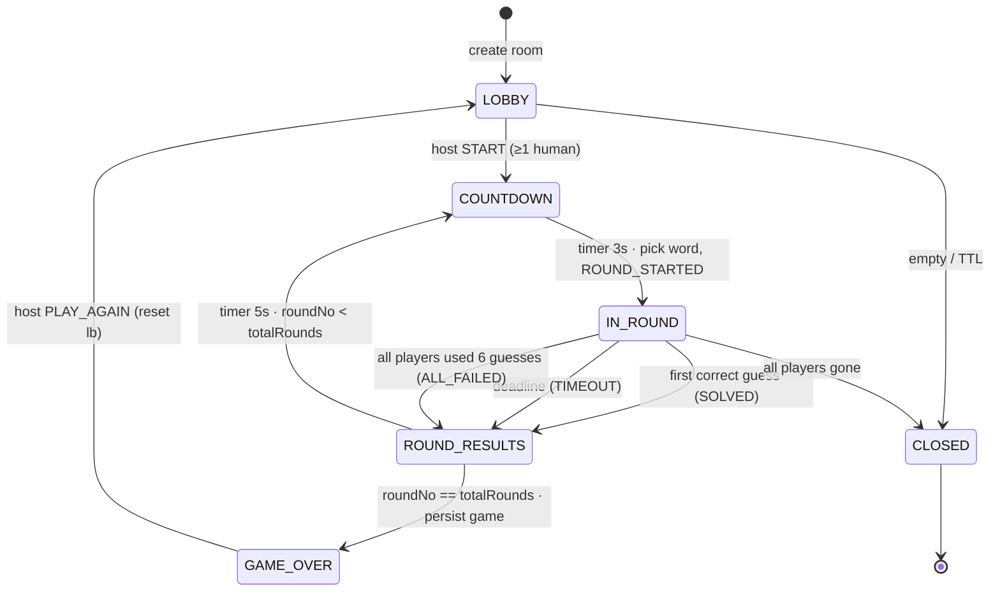

# WordRush: Multiplayer Wordle Race

Players join a room with a code. Everyone gets the same hidden 5-letter word, and the first player to solve it wins the round. A game has multiple rounds and a live leaderboard. **The server is authoritative.** It holds the answer, scores every guess, and decides who won. Clients only send guesses and draw what the server tells them.

**Stack:** Java 21 · Spring Boot 4.1 · STOMP over WebSocket · Spring Security (JWT) · PostgreSQL + Flyway · Redis · React + TypeScript (Vite) · Docker Compose · JUnit 5 / Mockito / Testcontainers · k6

**Repo layout (Gradle multi-project)**
```
wordrush/
├── backend/          Spring Boot app
├── game-core/        pure Java: word list, feedback, solver, scoring (no Spring, used by backend and bot)
├── bot/              CLI bot client (real STOMP client); also the load-test driver
├── frontend/         React + TS (Vite, @stomp/stompjs, Zustand)
├── infra/            docker-compose.yml, nginx.conf, prometheus.yml, grafana dashboards
└── loadtest/         k6 scripts
```

---

## 1. Architecture

```mermaid
flowchart LR
  subgraph Clients
    B[React app<br/>(you)]
    BOT[Bot clients<br/>CLI or in-app]
    K6[k6 load test]
  end
  B & BOT & K6 -- "REST (JWT)<br/>STOMP over WS" --> LB[nginx]
  LB --> A1[wordrush-backend #1]
  LB --> A2[wordrush-backend #2]
  subgraph App["Spring Boot (each instance)"]
    C[Controllers<br/>REST + @MessageMapping] --> S[Services<br/>RoomService, GameService,<br/>PresenceService, TimerService]
    S --> R1[Redis repositories<br/>+ Lua scripts]
    S --> R2[JPA / JDBC repositories]
    S --> GC[game-core<br/>Feedback, WordList, Scoring]
  end
  A1 & A2 -.-> App
  R1 --> RD[(Redis<br/>live room state, ZSET leaderboards,<br/>rate limits, timers, pub/sub)]
  R2 --> PG[(PostgreSQL<br/>users, games, rounds, guesses)]
  A1 & A2 -- "pub/sub room events" --- RD
  A1 & A2 --> PROM[Prometheus → Grafana]
```

**Key decisions**
- **Modular monolith, stateless app nodes.** All live state is in Redis, so any instance can handle any message. Postgres keeps durable history only and stays off the hot path for guesses.
- **Packages by feature, layered inside each:** `auth`, `room`, `game`, `presence`, `leaderboard`, `bot`, `history`, `common` (errors, logging, config). Every feature has `controller → service → repository`. DTOs are Java `record`s, and entities never leave the service layer.
- **Hot path:** a guess arrives over WS. The service validates it against the dictionary, computes feedback in Java, then runs **one Lua script** that handles idempotency, round state, attempt count, winner and leaderboard together. The guesser gets a private reply and the room gets a broadcast. Guesses are persisted to Postgres in a batch when the round ends.
- **Cross-instance broadcast:** each instance publishes room events to Redis channel `wr:events`. Every instance subscribes and relays them to its local STOMP simple broker. A RabbitMQ STOMP relay is the "next step" you can mention, but it isn't needed here.
- **Timers** (countdown, round deadline, results pause) live in one Redis ZSET `wr:timers` (member `roomCode|type`, score = due epoch ms). Every instance polls it every 250 ms. Each due entry is claimed with `ZREM`, and only the instance whose `ZREM` returns 1 fires the transition. That gives exactly-once handling without a leader.
- **Anti-cheat:** the answer never leaves the server before `ROUND_ENDED`. Opponents' progress is broadcast as colours only, never letters. Every WS frame is authorized: you can only SUBSCRIBE or SEND to rooms you belong to. Only words in the dictionary are accepted, and guesses are rate-limited.

---

## 2. Data model

### PostgreSQL (Flyway: `V1__init.sql`, `V2__...`; never edit an applied migration)

| Table | Columns | Notes |
|---|---|---|
| `users` | `id uuid PK`, `username citext UNIQUE`, `password_hash text NULL`, `is_guest bool`, `is_bot bool`, `created_at timestamptz` | Guests and bots have no password |
| `games` | `id uuid PK`, `room_code char(6)`, `host_id uuid FK users`, `total_rounds smallint`, `round_seconds smallint`, `status text`, `started_at`, `ended_at` | One row per game played |
| `game_players` | `game_id FK`, `user_id FK`, `final_score int`, `final_rank smallint`, **PK(game_id, user_id)** | Index `(user_id)` for stats |
| `rounds` | `id uuid PK`, `game_id FK`, `round_no smallint`, `answer char(5)`, `started_at`, `ended_at`, `winner_id uuid NULL`, `winner_attempts smallint`, `end_reason text` (`SOLVED`/`TIMEOUT`/`ALL_FAILED`), **UNIQUE(game_id, round_no)** | |
| `guesses` | `id uuid PK` (= client `guessId`), `round_id FK`, `user_id FK`, `attempt_no smallint`, `word char(5)`, `feedback char(5)` (e.g. `GYBBG`), `correct bool`, `received_at timestamptz` | **UNIQUE(round_id, user_id, attempt_no)**; index `(round_id)` |

Use JPA for `users` and `games`. Use `JdbcTemplate.batchUpdate` for `guesses`, a few hundred rows per round, which makes a good batching talking point.

### Redis keys (all room keys use the hash tag `{CODE}` so they share one cluster slot and Lua can touch them atomically)

| Key | Type | Contents | TTL |
|---|---|---|---|
| `wr:room:{CODE}` | HASH | `status, hostId, roundNo, totalRounds, roundSeconds, maxPlayers, gameId, seq` | 2 h, refreshed on activity |
| `wr:room:{CODE}:players` | HASH | `userId → {nickname,isBot,connected,joinedAt}` JSON | 2 h |
| `wr:room:{CODE}:round` | HASH | `roundId, answer, state, startedAt, endsAt, winnerId, winnerAt` | `roundSeconds + 10 min` |
| `wr:room:{CODE}:g:{userId}` | LIST | this round's guesses `word:feedback` | same as round; deleted on next round |
| `wr:room:{CODE}:lb` | ZSET | `userId → total points` (live leaderboard) | 2 h |
| `wr:room:{CODE}:used` | SET | answers already used this game, so words don't repeat | 2 h |
| `wr:room:{CODE}:presence` | ZSET | `userId → last heartbeat epoch ms` | 2 h |
| `wr:room:{CODE}:idem:{guessId}` | STRING | cached guess result JSON | 10 min |
| `wr:user:{userId}:room` | STRING | current room code (for reconnect) | 2 h |
| `wr:rl:{userId}:{action}:{window}` | STRING (INCR) | fixed-window counter: guesses 5/s, room create 10/min | window length |
| `wr:timers` | ZSET | `CODE\|TYPE → due epoch ms` | none (entries removed when claimed) |
| `wr:lb:global:{yyyy-Www}` | ZSET | weekly wins across all games | 8 days |
| `wr:events` | pub/sub channel | room event fan-out | n/a |

Room codes are 6 characters from `ABCDEFGHJKMNPQRSTUVWXYZ23456789` (no 0/O/1/I), generated with `SecureRandom` and reserved with `SET NX`. Word lists (answers ~2.3k, valid guesses ~13k) load once at startup into an immutable `Set<String>` in `game-core`. Use an openly licensed list.

---

## 3. API

### REST (`/api/v1`, JSON, errors as RFC 9457 `application/problem+json`)

| Method | Path | Purpose |
|---|---|---|
| POST | `/auth/guest` `{nickname}` | Create guest user → `{accessToken, user}` (JWT, 12 h) |
| POST | `/auth/register`, `/auth/login` | Optional persistent accounts (BCrypt) |
| GET | `/me` | Current user |
| POST | `/rooms` `{totalRounds 1–10, roundSeconds 30–180, maxPlayers 2–8}` | Create room (caller becomes host) → `{code}` |
| POST | `/rooms/{code}/join` | Join → `RoomSnapshot` (409 if full or started) |
| POST | `/rooms/{code}/leave` | Leave |
| GET | `/rooms/{code}` | `RoomSnapshot` (members only) |
| POST | `/rooms/{code}/bots` `{difficulty: EASY\|MEDIUM\|HARD}` | Host adds a bot |
| DELETE | `/rooms/{code}/players/{userId}` | Host kicks a player or bot |
| GET | `/games/{id}` | Finished game: rounds, answers, winners |
| GET | `/users/{id}/stats` | Games, wins, win %, avg attempts, guess distribution |
| GET | `/leaderboard/global?week=` | Weekly top 20 |
| — | `/actuator/health`, `/actuator/prometheus`, `/swagger-ui.html` | Ops and docs |

### WebSocket (STOMP, endpoint `/ws`, JWT in the STOMP `CONNECT` header `Authorization: Bearer …`, heart-beat `10000,10000`)

**Client → server (`/app/...`)**

| Destination | Payload | Notes |
|---|---|---|
| `/app/rooms/{code}/start` | `{}` | Host only, LOBBY → COUNTDOWN |
| `/app/rooms/{code}/guess` | `{guessId: uuid, roundId, word}` | Idempotent by `guessId` |
| `/app/rooms/{code}/heartbeat` | `{}` | Every 5 s; refreshes presence |
| `/app/rooms/{code}/playAgain` | `{}` | Host only, GAME_OVER → LOBBY |
| SUBSCRIBE `/app/rooms/{code}/state` | none | `@SubscribeMapping` returns a `RoomSnapshot` to this client only (used for resync) |

**Server → client.** Every event uses the envelope `{type, roomCode, seq, serverTime, payload}`. `seq` is a per-room counter (`HINCRBY`). If a client sees a gap in `seq`, it re-subscribes to `/state`.

| Destination | Type | Payload |
|---|---|---|
| `/topic/rooms/{code}` | `PLAYER_JOINED` / `PLAYER_LEFT` / `PLAYER_CONNECTION` | player, connected flag |
| | `HOST_CHANGED` | new hostId |
| | `COUNTDOWN` | `roundNo, startsAt` |
| | `ROUND_STARTED` | `roundId, roundNo, endsAt` (never the answer) |
| | `PLAYER_PROGRESS` | `userId, attempt, feedback` (colours only) |
| | `ROUND_ENDED` | `answer, winnerId, winnerAttempts, reason, runnersUp[] (+ms behind)` |
| | `LEADERBOARD` | `[{userId, nickname, score, rank}]` |
| | `GAME_OVER` | final standings, `gameId` |
| `/user/queue/guess-result` | `GUESS_RESULT` | `guessId, attempt, feedback, outcome: WON\|CORRECT_LATE\|WRONG\|OUT_OF_GUESSES` |
| `/user/queue/errors` | `ERROR` | `{code, message, guessId?}` (e.g. `NOT_A_WORD`, `RATE_LIMITED`, `ROUND_OVER`) |

In Java, model the events as a `sealed interface RoomEvent permits ...` of records and dispatch with pattern-matching `switch`.

**Reconnect/resync.** On refresh, the client reconnects with the same JWT, calls `GET /me`, finds its room via `wr:user:{id}:room`, then subscribes to `/topic/rooms/{code}` **first** and `/app/rooms/{code}/state` **second**, so no event is missed in between. The `RoomSnapshot` contains status, players with connection state, leaderboard, `round {roundId, roundNo, endsAt, yourGuesses[] with feedback, opponentsProgress[]}`, `serverTime` (the client works out clock offset from it) and `lastSeq`. The client drops queued events with `seq <= lastSeq`.

**Heartbeats and disconnects.**
1. The STOMP transport heart-beat detects dead TCP connections and fires `SessionDisconnectEvent`.
2. On disconnect the player is marked `connected=false` and `PLAYER_CONNECTION` is broadcast. The player is **not** removed yet.
3. `PresenceSweeper` (`@Scheduled` every 5 s) removes players whose last heartbeat is more than 30 s old (`ZRANGEBYSCORE presence 0 now-30000`, claimed with `ZREM`) and broadcasts `PLAYER_LEFT`. If the host left, the earliest-joined human becomes host. If the room is empty, its keys are deleted. If everyone left in the round has finished, the round ends.
4. The 30 s grace window is why a refresh doesn't kick you.

---

## 4. Room state machine



- Every transition is a **compare-and-set** in Lua: "if `status == expected` then set `new`, bump `seq`". That makes duplicate triggers harmless, for example a timer firing just as someone wins.
- Players can join only in `LOBBY`. Rejoining during a game is allowed only for existing members, which is the reconnect case.
- Scoring: the winner gets `100 + 20 × (6 − attempts)`. Nobody else scores that round, which keeps the race simple. Each win also does `ZINCRBY` on the room leaderboard and the weekly global ZSET.

---

## 5. Tie-breaking simultaneous solves

**Rule: the first correct guess *committed by Redis* wins.** That is server order, and no tie is possible at the commit point.

Why it works: Redis runs each Lua script atomically on a single thread. Two correct guesses landing in the same millisecond, even on different app instances, still run one after the other. `submit_guess.lua` does all of this as one unit:
1. If `idem:{guessId}` exists, return the cached result (idempotency).
2. Reject if `round.roundId != ARGV.roundId`, `state != IN_ROUND`, or `TIME > endsAt`.
3. Reject if the player already solved or has 6 guesses (`LLEN`).
4. `RPUSH` the guess.
5. If correct, `HSETNX round winnerId`. If that returns 1, set `state=ROUND_OVER` and `winnerAt=TIME`, `ZINCRBY` the leaderboard, schedule the results timer, and return `WON`. If it returns 0, return `CORRECT_LATE` and record the ms behind for the "runners-up" display.
6. Cache the result under `idem:{guessId}` with `EX 600` and return it.

What *not* to use, and why (good interview answers):
- **Client timestamps** can be forged.
- **`synchronized`/`ReentrantLock`** only works inside one JVM and breaks with two instances.
- **A Postgres row lock** is correct but puts the DB on the hot path. Keep it as a **second safety net** at persist time: `UPDATE rounds SET winner_id=? WHERE id=? AND winner_id IS NULL`.
- **Latency fairness** (a player closer to the server has an edge) is an acknowledged non-goal. Mention it.

Prove it with the concurrency test in Stage 7: 50 threads submit the correct word behind a `CountDownLatch`, repeated 1,000×, and exactly one `WON` comes back every time.

---

## 6. Bots (so you can play solo)

- **`game-core/Solver`** is pure Java. It keeps the candidate set of words still consistent with all feedback seen so far.
  - **EASY:** random candidate, 6–10 s think time, 20% chance of a "dumb" valid word.
  - **MEDIUM:** random candidate, 3–6 s.
  - **HARD:** picks the guess that minimises the expected remaining candidates, 1.5–3 s.
- **Bots only ever see their own feedback, never the answer.** They're honest players, and a contract test enforces this.
- **Two adapters, one solver** (ports and adapters):
  - **`bot` CLI:** a real `WebSocketStompClient`. It gets a guest JWT with `is_bot`, then runs as `java -jar bot.jar --room ABC234 --count 3 --difficulty MEDIUM`. It uses the full protocol, so it's also the e2e and load tool.
  - **In-app "Add bot":** `BotManager` runs each bot on a **virtual thread** and calls the same `GameService` methods a WS controller would, so validation, rate limits and idempotency still apply. Bots are removed when the game ends or the room closes.

---

## 7. Staged build order

Write unit tests in every stage. Stage 7 adds the heavy integration and concurrency tests.

| # | Stage | Done when… |
|---|---|---|
| 0 | **Skeleton:** Gradle multi-project; `infra/docker-compose.yml` (postgres:17, redis:7.4); Flyway `V1`; Actuator; JSON logging | `docker compose up -d && ./gradlew :backend:bootRun` → `/actuator/health` shows `db` and `redis` UP |
| 1 | **game-core:** `WordList`, `FeedbackEvaluator` (two-pass algorithm for duplicate letters), `Scoring`, `Solver` | Unit tests pass, including duplicate-letter cases (answer `ABBEY`/guess `BABES`, answer `SPEED`/guess `EERIE`); Solver solves 100% of answers in ≤6 at HARD; report average attempts |
| 2 | **Auth + rooms REST:** guest JWT, `SecurityFilterChain`, `JwtAuthFilter`, create/join/leave/get room in Redis, DTO validation, `@RestControllerAdvice` → `ProblemDetail`, springdoc OpenAPI | Swagger UI runs the full flow; no token → 401; bad body → 400 problem+json with field errors; full room → 409 |
| 3 | **WS gameplay MVP (single instance):** STOMP config, JWT on `CONNECT` and membership check on `SUBSCRIBE`/`SEND` via `ChannelInterceptor`, start → countdown → round → results → game over, `wr:timers` poller, live leaderboard ZSET, minimal React UI (home, lobby, board, opponent mini-boards, leaderboard) | Two browser windows play a 3-round game to GAME_OVER with correct winners and scores |
| 4 | **Bots:** `bot` CLI + `POST /rooms/{code}/bots` + in-app `BotManager` | You + 3 in-app bots finish a 5-round game; CLI bots join from a terminal; a test asserts no bot-bound message contains the answer before `ROUND_ENDED` |
| 5 | **Robustness:** `submit_guess.lua` (atomic winner + idempotency), rate limiting, heartbeats + `PresenceSweeper`, host migration, reconnect with `seq` + snapshot | Refresh mid-round → board restored in <1 s; closing a tab → `PLAYER_LEFT` within ~35 s; sending the same `guessId` twice → same result and one attempt counted; spamming guesses → `RATE_LIMITED` |
| 6 | **Persistence & history:** batch-persist rounds/guesses at round end, `games`/`game_players` at GAME_OVER, stats + game history + weekly global leaderboard | After a game, Postgres rows match what you saw; `/users/{id}/stats` is correct |
| 7 | **Testing:** Testcontainers (`@ServiceConnection` Postgres + Redis), `@WebMvcTest` controller slices, WS integration test with `WebSocketStompClient`, **concurrency test**, ArchUnit rule "controllers don't touch repositories", JaCoCo | `./gradlew test` green; concurrency test 1,000/1,000 single-winner; service-layer coverage ≥80% |
| 8 | **Observability:** Micrometer metrics (section 8), MDC (`roomCode`, `userId`, `traceId`) in JSON logs, Prometheus + Grafana in compose | Grafana shows guess latency p50/p95/p99, active rooms and connections live while bots play |
| 9 | **Horizontal scaling:** 2 backend replicas behind nginx (WS upgrade), Redis pub/sub event fan-out, `ZREM`-claimed timers and sweeper | Players on different instances share a room; `docker stop backend-1` → clients reconnect to backend-2 and resync with no lost round |
| 10 | **Load test:** k6 WS script (hand-written STOMP frames) with N rooms × 4 players guessing every 2 s; plus a bot-swarm mode | Report: max concurrent players at p95 guess RTT < 100 ms and error rate < 1%, for 1 vs 2 instances |
| 11 | **CI + polish:** GitHub Actions (build, Testcontainers tests, frontend build, Docker images), README with diagrams, metrics table, demo GIF | Green CI badge; `docker compose up` gives a playable app from a fresh clone |
| 12 | **Deploy to Render** (section 9): `render.yaml` Blueprint, env-var config, CORS/WS origins, health check | Friends open the public URL, join your room code from their own devices, and finish a game over `wss://` |

> **Prepare for deployment from Stage 0:** read all config from env vars (`server.port=${PORT:8080}`, `${DATABASE_URL}`, `${REDIS_URL}`, `${JWT_SECRET}`, `${ALLOWED_ORIGINS}`), never hard-code `localhost`, and build the backend as a Docker image. Deploying is then config work, not a rewrite.

---

## 8. Metrics to measure (for resume bullets)

| Metric | How | Micrometer name |
|---|---|---|
| Guess latency p50/p95/p99 (server) | `Timer` around the guess handler | `wordrush.guess.latency` |
| Guess round-trip time (client) | k6 `Trend` from SEND to `GUESS_RESULT` | k6 `guess_rtt` |
| Max concurrent WS connections and players per instance at SLO | k6 ramp until p95 > 100 ms or errors > 1% | `wordrush.ws.sessions` (Gauge) |
| Broadcast throughput (msgs/s) and fan-out latency | Counter + Timer around publish → deliver | `wordrush.events.published` |
| Throughput with 1 vs 2 instances | k6 at the same load | — |
| Correctness under contention | concurrency-test trials, double winners (target 0) | — |
| Resync time after refresh | client-side mark: reconnect → snapshot applied | `wordrush.resync.latency` |
| Dead-player detection time | disconnect → `PLAYER_LEFT` | `wordrush.presence.eviction.delay` |
| DB effect of batching | p99 guess latency with per-guess inserts vs batched at round end (A/B) | — |
| Rate-limit rejections | Counter | `wordrush.ratelimit.rejected` |
| Redis memory per active room | `MEMORY USAGE` over room keys | — |
| Test suite | # tests, coverage %, CI time | JaCoCo |

Bullet templates (fill in real numbers):
- "Built a server-authoritative real-time multiplayer game (Spring Boot, STOMP/WebSocket, Redis, Postgres) sustaining **N concurrent players across M rooms at p95 guess latency X ms**, load-tested with k6."
- "Guaranteed exactly one winner under simultaneous submissions using atomic Redis Lua scripts: **0 double-winners in 1,000 contention trials of 50 concurrent threads**."
- "Cut p99 guess latency **X%** by moving Postgres writes off the hot path into round-end batch inserts."
- "Scaled horizontally to 2 stateless instances via Redis pub/sub fan-out and lock-free distributed timers, raising throughput **X×** and surviving instance failure with <1 s client resync."

---

## 9. Deployment (Render, to play online with friends)

**You don't need Supabase.** Render hosts everything this stack uses. Supabase's real value is its own auth, realtime and auto-generated APIs, and those would replace exactly the backend you're building to show off.

| Component | Render service | Notes |
|---|---|---|
| Backend | **Web Service** (Docker, `backend/Dockerfile`, multi-stage build → `eclipse-temurin:21-jre`) | WebSockets are supported. Health check path `/actuator/health/readiness`. Flyway migrates on startup. |
| Frontend | **Static Site** (`npm run build`, publish `frontend/dist`) | Build-time env `VITE_API_URL=https://wordrush-api.onrender.com`, WS URL `wss://…/ws`. Add an SPA rewrite `/* → /index.html`. |
| PostgreSQL | **Render Postgres** | Map the connection string to `SPRING_DATASOURCE_*` (Render gives `postgres://`, but JDBC needs `jdbc:postgresql://`, so split it into URL/user/password env vars). |
| Redis | **Render Key Value** (Valkey, Redis-compatible) | Lua, ZSETs, TTLs and pub/sub all work. Use the internal URL. |

- **One `render.yaml` Blueprint** declares all four services and wires `DATABASE_URL`/`REDIS_URL` with `fromDatabase`/`fromService`. You get one-click infra-as-code, which also makes a good resume line.
- **CORS and WS origins:** `ALLOWED_ORIGINS=https://wordrush.onrender.com`, used both by the Spring Security CORS config and by `registry.addEndpoint("/ws").setAllowedOrigins(...)`.
- **Free-tier caveats (check current Render pricing, these change):**
  - Free web services sleep after ~15 min idle. The first visitor waits through a cold start and open WebSockets drop. Your reconnect/resync logic covers that, but a paid "Starter" instance avoids it for game nights.
  - Free Postgres has an expiry window.
  - Free Key Value has no persistence. Live rooms are lost on restart, which is acceptable because history is in Postgres.
- **Scaling (Stage 9) stays a local Docker Compose demo.** On Render you run 1 instance, and multi-instance only needs a paid plan plus the same code.
- **Keep Prometheus/Grafana local.** Render's built-in metrics and logs are enough in production (Grafana Cloud's free tier is optional).
- **Optional alternative:** use Supabase **only as a Postgres host** if Render's free DB expiry bothers you. Connect with plain JDBC through its **session-mode pooler** (port 5432 on the pooler host). The direct host is IPv6-only, and transaction-mode pooling breaks prepared statements. Free Supabase projects pause after a period of inactivity. No code changes are needed either way, only the env var.

## 10. Concepts to know for interviews

- **Spring IoC/DI:** beans, constructor injection, `@Configuration`/`@Bean`, profiles. Why constructor injection makes testing with Mockito easy.
- **Layered architecture and DTOs:** controllers handle HTTP/WS only, services hold business rules and transactions, repositories handle storage. Records as immutable DTOs. Never expose entities, because of over-posting, lazy-loading leaks and coupling.
- **Validation and errors:** `@Valid` + Jakarta constraints (`@Size`, `@Pattern("[A-Za-z]{5}")`). `@RestControllerAdvice` maps domain exceptions to `ProblemDetail`. Errors on the WS side go through `@MessageExceptionHandler` + `@SendToUser("/queue/errors")`.
- **Spring Security:** the filter chain, a stateless JWT `OncePerRequestFilter`, `SecurityContextHolder`, HS256 vs RS256. Browsers can't set headers on the WS handshake, so the token goes in the STOMP `CONNECT` frame and is checked in a `ChannelInterceptor`. Destinations need authorization, not just authentication.
- **STOMP:** `/app` (handled by `@MessageMapping`), `/topic` (broadcast), `/user/queue` (one user, resolved from the `Principal`). `SimpMessagingTemplate`, `@SubscribeMapping` for request/reply. Simple broker vs broker relay. Transport heart-beats.
- **JPA/Hibernate and transactions:** entity lifecycle, `@Transactional` as a proxy (self-invocation doesn't start a transaction), propagation, N+1 queries, `spring.jpa.open-in-view=false`. When to use `JdbcTemplate` instead (batch inserts).
- **Flyway:** versioned, immutable, checksummed migrations. Schema lives in code.
- **Redis:** pick the data structure to fit the access pattern (HASH, ZSET for ranking, LIST, SET). TTLs. Lua vs `MULTI` vs `WATCH`: only Lua gives conditional atomic logic. Hash tags for cluster slots. Pub/sub is fire-and-forget, so `seq` + snapshot cover missed messages.
- **Concurrency:** race conditions and check-then-act. Why JVM locks fail across instances. Idempotency keys. Exactly-once handling with atomic claims (`ZREM`). `@Scheduled` on N instances, and what ShedLock would add. Java 21 **virtual threads** (bots, `spring.threads.virtual.enabled=true`).
- **Java 21:** records, sealed interfaces + pattern-matching `switch` for event types, `var`, text blocks for Lua scripts.
- **Testing pyramid:** unit tests (JUnit 5 + Mockito), slice tests (`@WebMvcTest`, `@DataJpaTest`), integration tests (`@SpringBootTest` + Testcontainers `@ServiceConnection`), concurrency tests (`ExecutorService` + `CountDownLatch` + repetition), load tests (k6). What each one catches.
- **Observability:** Actuator health groups (liveness/readiness), Micrometer `Timer`/`Counter`/`Gauge` with percentiles, Prometheus scrape, structured logs + MDC for following a request across threads.
- **Distributed-systems vocabulary:** authoritative server, linearization point (the Lua script), at-least-once delivery + idempotency = effectively-once, eventual vs strong consistency (Redis live state vs Postgres history), graceful degradation on reconnect.
